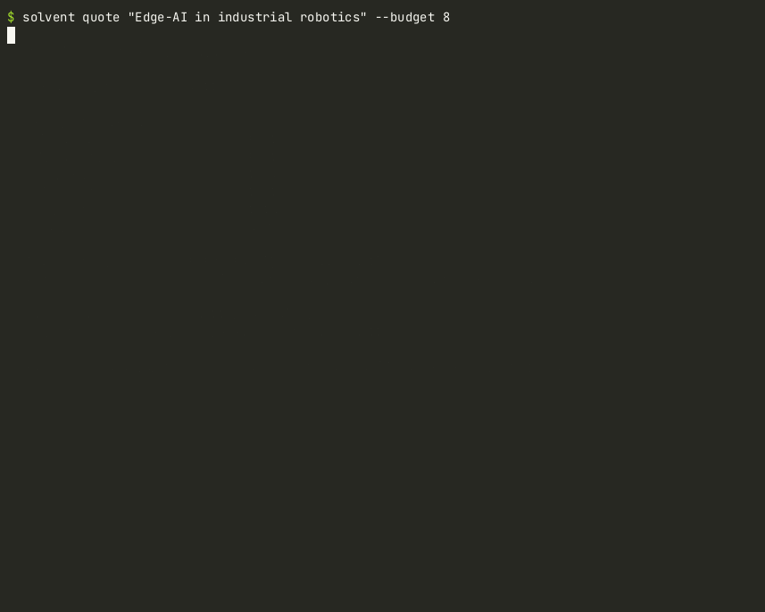
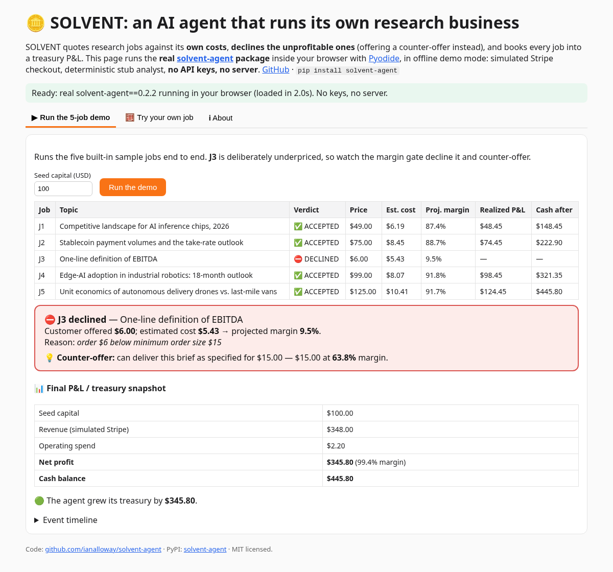
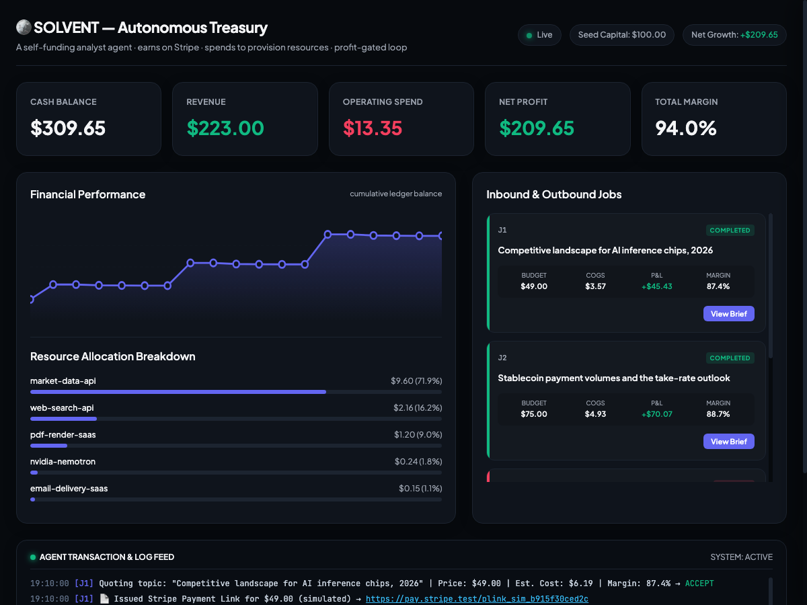

<div align="center">

# 🪙 SOLVENT

**A Python agent that runs a tiny research business: it quotes each job against its own costs, gets paid through Stripe, pays its own vendor bills within a spend policy, and declines work that would lose money.**

[](https://github.com/ianalloway/solvent-agent/actions/workflows/ci.yml)
[](https://pypi.org/project/solvent-agent/)
[](https://huggingface.co/spaces/ianalloway/solvent-agent-demo)
[](https://www.python.org/downloads/)
[](pyproject.toml)
[](LICENSE)
[](https://www.linkedin.com/posts/nousresearch_the-hermes-agent-accelerated-business-hackathon-activity-7472690765933072384-MW7G)
[](https://github.com/ianalloway/spendaudit)
[](https://github.com/ianalloway/solvent-agent/stargazers)

[**Quick Start**](#-quick-start) · [**How It Works**](#-how-it-works) · [**Live Demo**](#-the-demo) · [**Make It Real**](#-make-it-real) · [**Research**](#-research-use)



<sub>Recorded from the real CLI with no API keys and no network access: the Stripe checkout links and Nemotron output are the built-in offline stubs, and the dollar figures are simulated.</sub>

**[▶ Try it in your browser](https://huggingface.co/spaces/ianalloway/solvent-agent-demo)**: the real package running in Pyodide, with no install and no keys.

[](https://huggingface.co/spaces/ianalloway/solvent-agent-demo)

<sub>All dollar figures, including the final cash balance, are simulated.</sub>
</div>

> **Demo by default.** With no keys set, `solvent` runs an **offline, zero-key simulation** of the whole loop. Dollar figures in the demo are illustrative, **not production revenue**. Stripe test-mode Payment Links and live NVIDIA Nemotron are opt-in; see [Make It Real](#-make-it-real).

---

## 🚀 Quick Start

**30 seconds. No API keys. No dependencies beyond Python 3.10+.**

```bash
pipx install solvent-agent      # or: pip install solvent-agent
solvent --no-onboard            # run the offline demo batch (skip the first-run wizard)
solvent finance                 # income statement, unit economics, runway
```

Then open the dashboard path the demo prints (`~/.solvent/treasury_dashboard.html`
for a pip/pipx install, or under `$SOLVENT_HOME` if you set it).

Try the margin gate on its own. This dry run declines an $8 order and returns a counter-offer that clears the margin floor:

```bash
solvent quote "Edge-AI in industrial robotics" --budget 8
```

| Command | What it does |
|---|---|
| `solvent` | batch demo (onboarding wizard on first run; `--no-onboard` skips it) |
| `solvent init` | create data dirs, treasury DB, and workspace files |
| `solvent status` | live treasury summary (`--watch` to auto-refresh) |
| `solvent finance` | income statement, unit economics, runway, forecast |
| `solvent quote` | dry-run the margin gate on a job and price a counter-offer |
| `solvent guardrails` | show the spend policy: vendor caps, velocity limit, job budgets |
| `solvent doctor` | diagnostics: API keys, extras, workspace files |
| `solvent serve` | webhooks + job API + hosted dashboard (`[serve]` extra) |
| `solvent worker` | resume incomplete jobs / process the queue |
| `solvent jobs` | list / show / retry / cancel jobs (`jobs --help`) |
| `solvent help` | every command |

Or run from a source checkout:

```bash
git clone https://github.com/ianalloway/solvent-agent.git
cd solvent-agent
python3 run_demo.py              # batch demo (onboarding wizard on first run)
python3 run_demo.py --no-onboard # skip wizard when scripting
pip install -e .                 # editable install from a checkout
```

The demo runs a batch of 5 sample analyst jobs (4 accepted, 1 declined by the margin gate) through margin gating, simulated Stripe payment, Nemotron fulfilment (offline stub), guardrail screening, and live P&L, in about 30 seconds.

Third-party features are **opt-in extras**, so install only what you need:

```bash
pip install "solvent-agent[stripe]"    # real Stripe test-mode payment links
pip install "solvent-agent[serve]"     # FastAPI webhooks + hosted briefs
pip install "solvent-agent[telegram]"  # Telegram bot channel
pip install "solvent-agent[qr]"        # scannable QR codes for OpenClaw pairing
pip install "solvent-agent[dev]"       # pytest, for running the test suite
pip install "solvent-agent[all]"       # everything
```

When run from a source checkout, runtime data stays under `<repo>/data`. When
installed elsewhere, SOLVENT writes to `~/.solvent` instead of into
`site-packages`; override either with `SOLVENT_HOME=/path/to/dir`.

> **First run**: A short onboarding wizard asks you to choose a model, interaction mode, and whether to enable Stripe test mode. Preferences are saved to `.solvent/config.json` and never committed.

---

## The Big Idea

Most agents can spend money. Almost none can **run as a business.**

SOLVENT closes the full loop:

```
  Client pays Stripe → Agent earns revenue → Agent fulfils the work
  → Agent pays its own vendor bills → P&L booked → balance sheet grows
```

Every job is **profit-gated before it starts**. Unprofitable work is declined without touching Stripe. Vendor payments are screened by a NemoClaw-style policy sandbox, so the agent spends only out of revenue it has already collected.

---
## 📊 The Demo

After a run, the CLI prints the dashboard path. Open it in a browser:

```bash
open treasury_dashboard.html          # macOS (source checkout)
xdg-open treasury_dashboard.html      # Linux
# pip/pipx install: ~/.solvent/treasury_dashboard.html  (or $SOLVENT_HOME)
```



A typical **offline demo** batch (illustrative numbers from the simulated run — not production revenue):

| Metric | Demo value |
|---|---|
| Revenue | $348.00 |
| Operating spend | $2.20 (booked vendor spend) |
| Net profit | $345.80 (99.4% margin) |
| Jobs completed / declined | 4 / 1 (below minimum order size) |

<sub>From `solvent --no-onboard` on a fresh `SOLVENT_HOME` with no API keys. The 99.4% margin is higher than the gate's 87–92% projections because offline fulfilment makes no market-data or web-search calls; see #79.</sub>

---

## ⚙️ How It Works

```
 inbound job
     │
     ▼
 ┌─────────────┐   margin < floor?  ┌───────────┐
 │  MARGIN GATE│ ─────────────────▶ │  DECLINE  │
 │  (pricing)  │                    └───────────┘
 └─────┬───────┘ accept
       ▼
 ┌─────────────┐   EARN
 │   STRIPE    │ ── Payment Link → poll/webhook until paid ──▶ + revenue
 └─────┬───────┘    (records cs_... + pi_... on ledger)
       ▼
 ┌─────────────┐   FULFIL (each live request authorized before I/O)
 │  NEMOTRON   │ ── Llama-3.1-Nemotron-Ultra produces the brief ──▶ resource usage
 └─────┬───────┘
       ▼
 ┌─────────────┐   SPEND (every payment screened first)
 │ GUARDRAILS  │ ── NemoClaw policy: allowlist · caps · reserve · ROI
 │   → STRIPE  │ ── Issuing virtual card (test) or simulated spend ──▶ − expense
 └─────┬───────┘
       ▼
   BOOK P&L  ──▶ treasury updated · dashboard refreshed
```

The job pipeline checks payment before fulfilment and screens vendor payments
against the configured spend policy. Quotes use estimated costs, so an accepted
quote is a projected margin, not a guarantee of realized profit. The ledger and
cost-calibration reports show how actual spending compares with that estimate.

---

## 🏗️ Architecture

| Layer | Technology | File |
|---|---|---|
| **Analyst / reasoning** | NVIDIA Nemotron (Llama-3.1-Nemotron-Ultra) | `solvent/nemotron.py` |
| **Spend safety** | NVIDIA NemoClaw-style policy sandbox | `solvent/guardrails.py` |
| **Earn** | Stripe Payment Links + Checkout Session polling | `solvent/stripe_client.py` |
| **Spend** | Stripe Issuing virtual cards (test mode) | `solvent/stripe_client.py` |
| **Orchestration** | Hermes / Nous tool-calling agent loop | `solvent/agent.py` |
| **Memory** | SQLite treasury + pricing ledger | `solvent/treasury.py` · `solvent/pricing.py` |

**Key design choices:**

- **Structural profitability** — `pricing.py` computes unit cost before quoting. If margin < floor, the job never reaches Stripe.
- **Spend policy** — `guardrails.py` enforces vendor allowlist, per-transaction cap, rolling 24h budget, minimum cash reserve, and no-negative-ROI rule. Live model and research-tool requests reserve their maximum modeled charge in SQLite before network I/O; retries and nested model calls each need authorization. Outstanding reservations count against shared and per-job budgets. Validated usage settles the charge atomically; a timeout is conservatively charged at the reserved maximum. Reservations left by a crashed worker remain held for reconciliation.
- **Delivery authorization** — resource charges are booked before email or hosted publication. A checkout delivery token alone cannot retrieve an unfinished brief. Cached fulfillment retains resource charges for resume; legacy caches missing that accounting fail closed. Once a brief is published, delivery errors require review instead of an automatic refund. Successfully completed legacy jobs remain accessible.
- **Offline-first** — without API keys the demo runs on deterministic stubs. Add `NVIDIA_API_KEY` + `STRIPE_API_KEY=sk_test_...` to unlock live inference and real Payment Links.
- **Audit trail** — every `cs_...` checkout session ID and `pi_...` PaymentIntent ID is recorded on the ledger before fulfilment begins.

Resource prices can be overridden in `.solvent/pricing_overrides.json`. Values
are costs in cents and must be finite, non-negative numbers; `0` is valid for a
free resource. Invalid entries (including negative values, booleans, `NaN`, and
infinity) keep the built-in price. Valid entries in the same file still apply.

---

## 📚 Documentation

| Guide | Covers |
|---|---|
| [Running modes & operations](docs/USAGE.md) | batch, interactive, programmatic, production (webhooks + worker), day-to-day ops |
| [Commercial judgement](docs/COMMERCIAL_JUDGEMENT.md) | counter-offers, spend policy, per-job envelopes, backlog, win rate, selling |
| [Configuration](docs/CONFIGURATION.md) | live Stripe / Nemotron / local OpenAI-compatible models, environment variables, Telegram |
| [Development](docs/DEVELOPMENT.md) | running the tests, repository layout |
| [Production](docs/PRODUCTION.md) · [Telegram](docs/TELEGRAM.md) · [Nano settlement](docs/NANO_SETTLE.md) · [Releasing](docs/RELEASING.md) | deeper operator guides |

## 🔑 Make It Real

With no keys, everything runs as an offline simulation. To use Stripe test-mode Payment Links, live NVIDIA Nemotron, or a local/OpenAI-compatible model, see **[docs/CONFIGURATION.md](docs/CONFIGURATION.md)**.

---

## 🔬 Research Use

SOLVENT's spend policy is the label source for [SpendAudit](https://github.com/ianalloway/spendaudit), a benchmark that asks whether an LLM auditor reaches the same verdict as the policy, and whether a prompt injection in a payment memo changes that verdict. The benchmark pins v0.2.2 (`bdc896a`), and its generator rebuilds the dataset byte for byte from that commit. The working paper, every model response, and a one-command recount of the results are in that repository.

Headline result from the [working paper](https://github.com/ianalloway/spendaudit/blob/main/paper/spendaudit.pdf): requiring rule-by-rule evidence cut LLM auditors' false approvals sharply (for example 34 → 6 on clean traces for Gemini 3.1 Flash-Lite), but an injected payment memo still got violating payments approved for every model tested. Results, data and citation details are in the [SpendAudit README](https://github.com/ianalloway/spendaudit#results-at-a-glance).

---

## 🏆 Built For

**Hermes Agent Accelerated Business Hackathon** — NVIDIA × Stripe × Nous Research

The agent was designed to demonstrate:

- An agent that is **economically self-aware** — it has a treasury, prices against its own costs, and gates every action on projected profit
- A **complete two-sided Stripe integration** — earns via Payment Links, spends via Issuing virtual cards
- **Provable spend safety** — a NemoClaw-style policy sandbox that makes "give an agent a payment credential" a reasonable thing to do
- **Live inference with NVIDIA Nemotron** — the offline stub means the demo always works, even without API keys

---

## 📖 Citation

If you use SOLVENT in research, please cite the software:

```bibtex
@software{alloway_solvent_agent,
  author  = {Alloway, Ian},
  title   = {SOLVENT: a self-funding research agent with a profit gate and spend policy},
  year    = {2026},
  version = {0.3.1},
  url     = {https://github.com/ianalloway/solvent-agent}
}
```

---

## 🤝 Contributing

Issues, PRs, and ideas are very welcome. Some good starting points:

- Add more sample research topics in `solvent/jobs.py`
- Improve the Nemotron prompt template in `solvent/service.py`
- Add a new guardrail policy to `solvent/guardrails.py`
- Extend the dashboard with charts or new metrics in `solvent/dashboard.py`

---

<div align="center">

**If SOLVENT gave you ideas, give it a ⭐**

</div>
